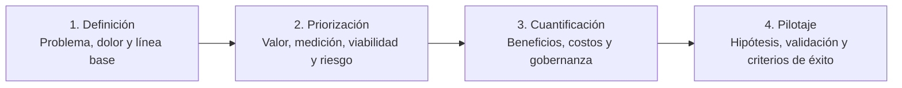
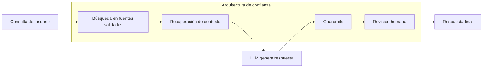

Me costó mucho terminar esta publicación. La presentación fue hace más de un mes y la tenía en mi lista de pendientes, pero no quería compartir algo simple, y tampoco un resumen tan complejo que nadie terminara de leerlo. Le di muchas vueltas y revisé una y otra vez las referencias y los cálculos. Si sigo así, no la publico nunca. Voy a resumirla de la mejor forma que puedo y aportar lo que sé, pero si me equivoco en algún cálculo o en algún dato, espero que me lo digas por <a href="https://www.linkedin.com/in/edgardo-vasquez/" target="_blank" rel="noopener noreferrer">LinkedIn</a>.

La masterclass fue el 2 de septiembre y la dictó <a href="https://www.linkedin.com/in/juancarloslanasocampo/" target="_blank" rel="noopener noreferrer">Juan Carlos Lanas</a> en UEjecutivos FEN U. de Chile. De ahí salen casi todas las ideas que ordeno acá. Lo que es mío lo voy marcando, para que no se confunda.

Hay algo que veo una y otra vez en las empresas: nos enamoramos de la novedad antes de mirar el impacto. Si trabajas en una, seguro lo has visto. Todos quieren "usar IA", como si fuera un remedio para cualquier ineficiencia, y la estrategia queda para después. Esa es la parte que me molesta.

<figure>

  

  <figcaption>Elaboración propia con OpenCode (DeepSeek V4.1 Flash).</figcaption>

</figure>

## El espejismo de la herramienta brillante

La clase lo llama así y la imagen me pareció precisa: implementamos algo tecnológicamente sofisticado que en la práctica no resuelve ningún dolor real ni deja un retorno que se pueda medir.

Y no pasa por falta de acceso a la tecnología. Hoy cualquiera puede entrar y usar OpenAI, Claude, Gemini u OpenCode y hacer algo. Lo que falta es la capacidad de la organización para producir mejoras verificables.

Dicho de otra forma: el éxito no es "usar IA", es integrarla en un flujo de trabajo con métricas claras. La clase ordena ese camino en cuatro bloques:

El resto del post sigue ese orden, más o menos.

## Las 5 reglas de oro

Si andas apurado y no vas a leer todo, quédate con estas cinco. Son las que dejó la masterclass y las que yo también intento aplicar:

| #   | Regla                                        | En simples palabras                                            |
| --- | -------------------------------------------- | -------------------------------------------------------------- |
| 1   | **Comenzar por el problema**                 | El dolor del negocio es la brújula                             |
| 2   | **Medir la línea base**                      | Sin el estado actual, el éxito es solo una opinión             |
| 3   | **Descartar lo que no puedo medir**          | Si la medición no llega a 3 de 5, no lo ejecutes (Regla del 3) |
| 4   | **Incluir costos de operación y gobernanza** | Tokens, infraestructura y supervisión humana también cuentan   |
| 5   | **Escalar con resultados**                   | Solo avanza de horizonte con beneficios verificables           |

De dónde sale cada una es, básicamente, el resto del post.

## Empieza por el problema, no por la herramienta

El punto de partida no es lo que puede hacer el modelo, es el dolor concreto del proceso. Y el error es definir ese dolor con *"no estamos usando IA"*. Eso no es un problema. El problema es lo que hay detrás: la gente que rehace planillas, los correos que nadie contesta, las horas que se van en tareas que no aportan.

Antes de invertir conviene mirar los datos. A esto se le llama <a href="https://www.linkedin.com/pulse/data-readiness-checklist-de-6-elementos-clave-para-el-%C3%A9xito-empresarial-zef2e/" target="_blank" rel="noopener noreferrer">Data Readiness</a> (preparación de datos), y en simple es: si están incompletos, desordenados o sucios, la probabilidad de fracaso sube.

Me quedó una idea dando vueltas y voy a intentar responderla:

> "La idea no es evaluar las novedades tecnológicas, sino la capacidad de producir una mejora verificable dentro del contexto de un proceso de negocio."

Para aterrizar la idea, la clase propone describirla en tres partes:

| Componente        | Qué define                                                 | Ejemplo                                                   |
| ----------------- | ---------------------------------------------------------- | --------------------------------------------------------- |
| **Tareas**        | Acciones exactas que ejecutará la IA y usuarios impactados | Resumir 500 correos diarios del equipo de soporte         |
| **Datos**         | Fuentes, niveles de acceso y preparación                   | Historial de tickets clasificados por categoría           |
| **Restricciones** | Límites éticos, normativos y de cumplimiento               | No exponer datos personales de clientes en las respuestas |

### Mi aporte: cómo se mide un caso de uso

| Caso de uso                 | Antes                    | Después                                    | Reducción |
| --------------------------- | ------------------------ | ------------------------------------------ | --------- |
| Procesamiento de documentos | 45 min por factura       | 5,5 min (extracción + revisión)            | **88%**   |
| Asistente de código         | 3 días por funcionalidad | 1,5 días                                   | **50%**   |
| Resumen de reuniones        | 120 min                  | 15 min (transcripción + revisión)          | **88%**   |
| Clasificación de emails     | 120 seg                  | 11 seg (5 seg + retrabajo del 5% de casos) | **91%**   |

La cuenta es la misma en todos los casos: (tiempo actual − tiempo con IA) / tiempo actual. Las cifras son estimaciones mías para ilustrar, no mediciones de un proyecto real. En tu empresa cada número tiene que salir de tu propia línea base, porque si no, estás comparando peras con manzanas.

## Sin línea base no hay ROI

Un error que veo es lanzar el piloto sin haber medido el estado actual. Después, cuando las cosas mejoran, nadie sabe cuánto mejoraron. El éxito queda en una percepción y no en un número.

Para calcular el retorno, la clase propone el **Valor de Transformación**:

**Valor de Transformación = Ingresos + Reducción de Costos + Productividad + Valor para el Cliente + Riesgo Evitado**

Y estas son las cinco cosas que hay que medir antes de tocar nada:

| Dimensión    | Qué medir y en qué unidad                                                                            | Dónde buscar el dato             |
| ------------ | ---------------------------------------------------------------------------------------------------- | -------------------------------- |
| **Tiempo**   | Duración de tareas, ciclos y esperas en colas (horas o días)                                         | Registros de sistemas, monitoreo |
| **Costo**    | Horas-hombre, costos operativos y retrabajo (moneda local o USD)                                     | Contabilidad, nómina             |
| **Calidad**  | Tasas de error, devoluciones, reclamos y cumplimiento de estándares (porcentaje)                     | Auditoría, control de calidad    |
| **Servicio** | Cumplimiento de acuerdos de nivel de servicio, casos pendientes, abandono y satisfacción del cliente | CRM, mesa de ayuda               |
| **Riesgo**   | Exposición de datos, trazabilidad y necesidad de revisión manual (nivel, eventos)                    | Registros de incidentes          |

### El caso de los 1,2M de contactos

Usemos números para que se entienda mejor (o eso espero). Una operación con 1,2 millones de contactos al año y un costo de USD 10 por contacto (salario, infraestructura, tecnología y supervisión incluidos) gasta USD 12M al año.

Con esa línea base puedes proyectar algo concreto: si el 15% de esos contactos se resuelve en autoservicio, son **USD 1,8M de ahorro bruto al año, antes de los costos de operar la IA**.

Sin la línea base, ese 1,8M es una opinión, pero con la línea base, es un dato.

### Mi aporte: VAN, TIR y ROI con los números del chatbot

Si el proyecto pasa por un comité de inversión, decir "esto ahorra" no basta. Te van a pedir dos cosas: el **VAN** (Valor Actual Neto, el valor de hoy de los flujos futuros menos la inversión) y la **TIR** (Tasa Interna de Retorno, la rentabilidad anual equivalente).

Sigo con el mismo caso, que en la práctica es un chatbot de autoservicio, y con estos supuestos, que son ilustrativos:

- **Inversión inicial:** USD 2.000.000 (integración con CRM, arquitectura RAG, licencias, desarrollo y gestión del cambio).
- **Ahorro bruto:** USD 1.800.000 al año, cuando el 15% de autoservicio funciona completo.
- **Costos de operación:** USD 600.000 al año (tokens, infraestructura, supervisión y mantenimiento). Flujo neto: **USD 1.200.000**.
- **Año 1 a la mitad:** USD 600.000, porque la adopción no llega al 15% el primer día.
- **Horizonte:** 3 años, con un costo de capital del 12%.

| Año     | Flujo neto     | Valor actual al 12% |
| ------- | -------------- | ------------------- |
| 0       | −USD 2.000.000 | −USD 2.000.000      |
| 1       | USD 600.000    | USD 535.714         |
| 2       | USD 1.200.000  | USD 956.633         |
| 3       | USD 1.200.000  | USD 854.136         |
| **VAN** |                | **USD 346.483**     |

El VAN es positivo, así que el proyecto genera valor por sobre lo que exige el costo de capital. La TIR, que es la tasa que deja el VAN en cero, da **cerca de 20,8%**: casi 9 puntos porcentuales por sobre el 12% exigido.

Hay dos cosas que cambian el resultado y que te conviene tener claras antes de que te las pregunten:

- **Los costos de operación importan.** Si te olvidas de los USD 600.000 de tokens, infraestructura y supervisión, el flujo sube a USD 1,8M y el proyecto se ve mucho mejor de lo que es. Es la regla 4 de la lista en acción.
- **La curva de adopción también.** Si asumes el 100% del beneficio desde el año 1, inflas el VAN. Y si con un escenario pesimista (autoservicio al 10%, tokens más caros) el VAN se vuelve negativo, el piloto tiene que validar justamente ese supuesto.

Si quieres replicarlo, pon la inversión en B8 y los flujos de los años 1 a 3 en B9:B11 (600000, 1200000, 1200000). Para el VAN aplica `VNA` con la tasa del 12% sobre B9:B11 y súmale B8, y para la tasa usa `TIR` sobre B8:B11 (en inglés, `NPV` e `IRR`). Así queda la planilla, en las dos versiones:

<figure>
  
  <figcaption>Elaboración propia en Excel, con los supuestos de este caso.</figcaption>
</figure>

<figure>
  
  <figcaption>La misma planilla en Google Sheets. Ahí las funciones se llaman "NPV", "IRR" y "SUM".</figcaption>
</figure>

El **ROI** (Retorno de la Inversión) es la ganancia total del periodo sobre lo invertido, no una tasa anual. Acá da 50% en tres años, que no es lo mismo que el 20% anual de la TIR.

## Priorizar es saber decir "no"

No todas las ideas merecen presupuesto. Decir que no también es parte del trabajo, y es de las cosas que más me ha costado aprender.

La clase propone puntuar cada iniciativa del 1 al 5 (1 = bajo o marginal, 5 = alto o estratégico) en cinco criterios:

| Criterio       | Qué evalúa                                                                                    |
| -------------- | --------------------------------------------------------------------------------------------- |
| **Relevancia** | Qué tan importante es el problema para la estrategia del negocio                              |
| **Impacto**    | Beneficio potencial (volumen × costo unitario)                                                |
| **Medición**   | Si existen KPIs y series históricas confiables (este puntaje es el que decide la Regla del 3) |
| **Viabilidad** | Disponibilidad de datos, responsables y tecnología                                            |
| **Riesgo**     | Nivel de exposición y controles requeridos (acá 5 significa riesgo bajo)                      |

Con esos puntajes aplicas dos filtros, y el orden importa: primero descartas, después ordenas.

### La Regla del 3: si no se mide, no se ejecuta

El nombre confunde un poco. No habla de tres reglas ni de tres criterios, sino del **umbral 3 en la escala de 1 a 5**, aplicado al criterio de **Medición**. Si una iniciativa saca menos de 3 ahí, se descarta, aunque tenga impacto alto y la tecnología esté lista.

La razón: sin KPIs ni una serie histórica confiable no tienes línea base, y sin línea base no puedes demostrar que mejoraste nada. Terminas defendiendo el proyecto con opiniones, que es justo lo que la regla 2 de la lista intenta evitar. El corte es una heurística (una regla práctica, sin respaldo estadístico), no una frontera validada, pero ordena la conversación y te ahorra pilotos que nadie va a poder evaluar.

Así se ve en la práctica:

| Iniciativa                                    | Puntaje en Medición                                              | Qué haces                                                |
| --------------------------------------------- | ---------------------------------------------------------------- | -------------------------------------------------------- |
| Asistente que redacta respuestas de soporte   | 4: ya registras tiempo por ticket, volumen y tasa de reescritura | Pasa a la matriz y, si el impacto se sostiene, a piloto  |
| "Usar IA para que el equipo sea más creativo" | 2: no hay KPI ni datos previos                                   | Se descarta, o se reformula hasta que exista una métrica |

En el segundo caso la idea no es mala: todavía no es una iniciativa, porque no hay forma de saber si funcionó.

### La matriz Impacto vs. Viabilidad

Las que sobrevivieron al filtro anterior se ordenan cruzando impacto y viabilidad:

| Impacto / Viabilidad        | **Viabilidad baja**                                      | **Viabilidad alta**                                                |
| --------------------------- | -------------------------------------------------------- | ------------------------------------------------------------------ |
| **Impacto alto**            | Reformular alcance: vale la pena, pero hay que refinarla | Avanzar a piloto (por ejemplo, asistentes de conocimiento con RAG) |
| **Impacto bajo o incierto** | Postergar                                                | Explorar y medir                                                   |

Con la lista ya ordenada, entra también **FinOps** (gestión financiera de los servicios en la nube): cuánto gastas en APIs de IA contra cuánto ahorras en tiempo de personas. Con modelos como OpenAI, Claude o Gemini el costo va por tokens, y <a href="https://help.openai.com/en/articles/4936856-what-are-tokens-and-how-to-count-them" target="_blank" rel="noopener noreferrer">OpenAI estima que un token equivale a unos 4 caracteres, o unas 3/4 de palabra en inglés</a>. Son dos heurísticas independientes, para inglés, no una fórmula exacta.

Y en español el mismo texto suele consumir más tokens, así que si estimas costos con esa regla probablemente te quedes corto. Lo que yo hago es pasar un par de textos reales por el <a href="https://platform.openai.com/tokenizer" target="_blank" rel="noopener noreferrer">tokenizer</a> y sacar mi propio promedio.

La pregunta que decide si escalas es simple: ¿cuánto me cuesta esta función de IA al mes y cuánto me ahorra en tiempo de personas?

## Del piloto a la escala

Una vez que la iniciativa está priorizada, el piloto se diseña como un experimento: una **hipótesis** clara (por ejemplo, "el asistente reduce en 30% el tiempo de respuesta"), **pruebas de validación** contra la línea base y **criterios de éxito** definidos antes de partir. Si esos criterios se definen después, gana la interpretación más cómoda.

Para no jugarte todo de una vez, la IA se financia por horizontes:

| Horizonte   | Plazo           | Enfoque                    | Ejemplo                                                                  |
| ----------- | --------------- | -------------------------- | ------------------------------------------------------------------------ |
| **H1**      | 3-6 meses       | Validación de valor        | Copilotos de asistencia, resúmenes automáticos                           |
| **H2**      | 6-12 meses      | Escalado de casos exitosos | RAG robusto, agentes con autonomía supervisada                           |
| **H3 / H4** | Más de 12 meses | Industrialización          | Reutilización de componentes, interoperabilidad y optimización de costos |

Cada horizonte se activa solo si el anterior mostró beneficios que se puedan verificar y comparar con los KPIs del piloto.

### ¿En qué nivel está tu organización?

La adopción es un camino, no un interruptor. La clase planteó cinco niveles:

| Nivel              | Qué se ve en el día a día                                                        |
| ------------------ | -------------------------------------------------------------------------------- |
| 1. Conciencia      | Cada quien usa ChatGPT a su manera, sin estándares ni registro de qué datos sube |
| 2. Experimentación | Pilotos controlados y documentados, pero sin escala                              |
| 3. Formalización   | Políticas de uso, gobernanza de datos y un responsable de IA                     |
| 4. Integración     | La IA se conecta a los sistemas centrales y hay beneficio capturado              |
| 5. Transformación  | La IA redefine el modelo de negocio, no es una herramienta más                   |

En mi experiencia, la mayoría de las organizaciones está en los niveles 1 o 2, y el error es querer saltar al 5 sin pasar por los intermedios.

### La gobernanza y la IA "en las sombras"

Gente usando cuentas personales para procesar datos de la empresa. En planes de consumo, si el interruptor de privacidad está apagado, esa información puede terminar usándose para entrenar modelos. En entornos corporativos conviene trabajar en espacios aislados, no en la cuenta que alguien abrió con su correo particular.

Y hay que entender cómo funcionan: los LLM (Modelos de Lenguaje de Gran Escala) están hechos para predecir la próxima palabra, así que pueden sonar seguros y estar equivocados. Esas son las famosas **alucinaciones**.

| Riesgo               | Cómo se mitiga                                                                                                                                                                          |
| -------------------- | --------------------------------------------------------------------------------------------------------------------------------------------------------------------------------------- |
| **Alucinaciones**    | **RAG** (Generación Aumentada por Recuperación): conectar el modelo a fuentes validadas, por ejemplo con una base de datos vectorial, para que responda con datos reales                |
| **Privacidad**       | Cumplimiento de la <a href="https://www.bcn.cl/leychile/navegar?idNorma=1209272" target="_blank" rel="noopener noreferrer">Ley 21.719</a> y control de acceso a la información sensible |
| **Sesgos y errores** | Guardrails (reglas que filtran lo que entra y sale del modelo) y supervisión humana                                                                                                     |
| **Trazabilidad**     | Registros, versionado de prompts y observabilidad de punta a punta                                                                                                                      |

La supervisión humana no se negocia: si el flujo no tiene hitos de aprobación, la cadena se rompe. Así se ve una arquitectura de confianza:

## Preguntas frecuentes

### ¿Qué diferencia hay entre VAN y TIR?

El VAN es un monto: los flujos futuros traídos al valor de hoy, menos la inversión. La TIR es una tasa: la rentabilidad anual que hace que ese VAN sea cero. Si el VAN es positivo, la TIR supera la tasa de descuento. Cuando comparas proyectos de distinto tamaño o duración los dos indicadores pueden contradecirse, y en ese caso manda el VAN, porque está en dinero y no en porcentaje.

### ¿Cuánto tiene que dar el ROI para aprobar un proyecto?

No hay un número universal. La referencia es la tasa de descuento, que es el costo de capital o la rentabilidad mínima que exige la empresa. Si la TIR la supera y el VAN es positivo, el proyecto crea valor. Muchas organizaciones piden además un margen extra por el riesgo. En el ejemplo del chatbot, 20,8% contra 12% deja casi 9 puntos porcentuales de holgura.

### ¿Qué hago si no tengo línea base?

Medirla ahora, antes del piloto, con lo que ya existe: registros de tickets, planillas, CRM o el reloj de quien hace la tarea. No necesitas un sistema nuevo. Toma una muestra durante dos semanas, anota tiempo, costo, tasa de error y volumen, y déjala por escrito antes de intervenir. Ese documento es lo que va a defender el proyecto cuando te pregunten cuánto mejoró.

### ¿Cómo estimo el costo en tokens?

Pasa un par de casos reales por el tokenizer, saca el promedio de tokens por caso de uso y multiplícalo por el volumen mensual y por el precio del modelo. Agrégale un margen: las respuestas largas y el contexto que recupera un RAG consumen más de lo que parece. Y no olvides los costos fijos, que son la infraestructura y la supervisión humana.

## Cierre

La IA Generativa es el puente entre lo que el negocio necesita y lo que la organización es capaz de construir. Pero un puente sin cimientos (datos) ni planos (línea base) se cae.

Si quieres profundizar, la clase completa está en la grabación de YouTube:

👉 <a href="https://www.youtube.com/watch?v=zepTbzNGLP8" target="_blank" rel="noopener noreferrer">Masterclass: ¿Cómo Evaluar Iniciativas de IA Generativa con Impacto Medible? | FEN U. de Chile</a>

Y te dejo la pregunta con la que me quedé: *¿en qué nivel de madurez está tu organización hoy? ¿Tiene la visibilidad para medir el impacto real, o está persiguiendo el ruido del mercado?*

Si tienes preguntas o quieres conversar sobre esto, me encuentras en <a href="https://www.linkedin.com/in/edgardo-vasquez/" target="_blank" rel="noopener noreferrer">LinkedIn</a>.